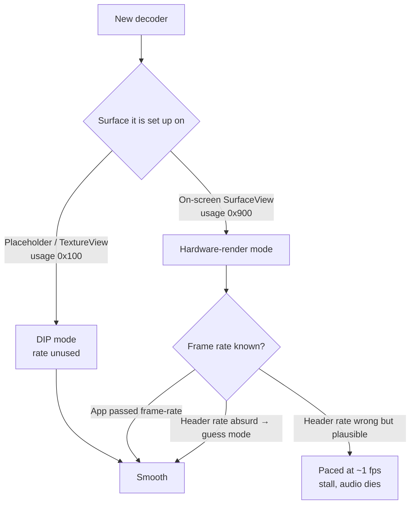

# Spotify music videos on TCL / MStar Android TVs: root cause and fix

<p align="center">
  <b>Spotify music videos drop to ~2 fps and lose their audio the moment you skip, autoplay or the quality goes up.</b><br>
  This repo explains why, down to the vendor decoder, and patches the Spotify TV app so they play smoothly. No root needed.
</p>

<p align="center">
  
  
  
  
</p>

---

## TL;DR

| | |
|---|---|
| **Symptom** | The first music video plays fine. Skip to the next one, let it autoplay, or let the quality step up, and the picture drops to about one frame every few seconds. A few seconds later the audio stops. |
| **Root cause** | Spotify's video streams declare a **wrong frame rate** in their H.264 header (e.g. 1 tick per 3,050 units ≈ 1,525 fps), and Spotify's player never passes the real frame rate to the decoder. The TV's MStar decoder then trusts the header. In its **hardware-render** mode (used when a decoder is set up on an on-screen `SurfaceView`) the TV's video plane paces playback at that bogus rate, about 1 fps, and the stream stalls. Spotify sets up a new decoder for every video and every quality change, always on its on-screen `SurfaceView`, except the very first one. |
| **Fix** | Patch Spotify's player (Media3) so every decoder is first set up on an **off-screen placeholder surface**, which gets the working mode, then moved to the real screen right before its first frame. |
| **Root needed?** | No. The patched app is re-signed with your own key and installed over adb. |

---

## The hardware

| | |
|---|---|
| TV | TCL "Smart TV Pro" 4K, sold as **55C825** (product `G05_4K_GB`, device `G05`) |
| SoC | **MediaTek / MStar MT5889**, `armeabi-v7a` (32-bit userspace), Mali GPU, ~2.7 GB RAM |
| Panel / UI | 3840×2160 panel; Android UI at 1920×1080, 60 Hz (50 Hz mode available) |
| OS | Android TV 11, build `AR2101`, fingerprint `TCL/G05_4K_GB/G05:11/AR2101/AR28` |
| Firmware | **`V8-T615T03-LF1V620`** (built 13 Jun 2025, security patch 2025-05-05), the latest TCL published for this chassis |
| Video decoder | `OMX.MS.AVC.Decoder` from `/vendor/lib/libOMX.MStar.so` (adaptive playback, max 1920×1080) |
| App | Spotify for Android TV `com.spotify.tv.android` **9.1.94.1926**; player "Betamax" on **AndroidX Media3 1.11.0** |

Other TVs built on the MStar/MediaTek `T615`/`MT58xx` TV platforms (several TCL, Philips and Sharp models) use the same decoder library. They are likely affected too, but they haven't been tested.

---

## Symptoms

- The first video after opening Spotify plays perfectly.
- **Skipping** to another video while one is playing breaks it.
- **Autoplay** from one video to the next breaks it.
- **Quality going up** mid-video can break it.
- Going back to the menu and choosing the next video works, and so does force-closing the app.
- Once broken, the picture shows about one new frame every few seconds. Spotify then flips between *playing* and *buffering* about 3× per second, and the audio track is restarted until the audio dies too.

---

## Root cause

Four things have to line up. Remove any one and the video plays.

### 1. Spotify's streams carry a wrong frame-rate field

H.264 streams can declare their frame rate in the sequence header (VUI `timing_info`). Spotify's music-video encodes fill it with junk:

| Spotify stream | `num_units_in_tick` / `time_scale` | Declared rate |
|---|---|---|
| 1552×1080, 1568×1088, 1056×720 | 1 / 2,000,000 | ~1,000,000 fps |
| 1280×720 and the Angèle videos (Jalousie, Tout oublier, La thune, Balance ton quoi) | 1 / 3,050 | ~1,525 fps |

Normal players ignore this field, because the real timing comes from the container.

### 2. Spotify's player doesn't pass the real frame rate

Spotify's streams don't declare a frame rate the player can read, so the `MediaFormat` it configures the decoder with has no `frame-rate` key. The decoder logs `Demuxer Frame Rate = 0 0`.

### 3. The MStar decoder then trusts the header

With no rate from the app, `libOMX.MStar.so` falls back to the header:

- If the header rate is absurd (~1,000,000 fps), it logs `Enter FrameRate Guess Mode`, estimates from timestamps, and gets it right: `force frame rate in = 24000`.
- If it's merely wrong (~1,525 fps), it passes the decoder's sanity check and ends up as `force frame rate in = 1000, out = 0`, which is 1 fps.

### 4. Only the hardware-render mode uses that rate

The decoder picks its output mode from the **consumer usage** of the surface it is set up on:

```text
DIP mode         MS_OSAL_BUFFER: ConsumerUsage: 100, Hardware Render: 0
(placeholder,    Enable DIP Detile/MFDEC ... SW render with DIP-MFDEC support
 TextureView)    → frames go through SurfaceFlinger, paced by their timestamps

hardware-render  MS_OSAL_BUFFER: ConsumerUsage: 900, Hardware Render: 1
(on-screen       GRM: AcquireDispBuf OK: 0
 SurfaceView)    → frames go to the TV's video plane, paced by the decoder's frame rate
```

In hardware-render mode, the video plane releases frames at the bogus rate. The decoder runs out of output buffers and produces 0–3 frames a second. Spotify's player then flips between *playing* and *buffering* until the audio dies. In DIP mode the rate is never used, so the same stream plays fine.

### Why the first video works

Media3 sets up a decoder on its off-screen **placeholder surface** (DIP mode) only when no display surface exists yet. That's only true for the first video after Spotify opens, or after going back to the menu. Every later decoder is set up on the on-screen `SurfaceView` (hardware-render mode). It breaks only if that video's header carries a "plausible" wrong rate rather than an absurd one, so some videos break and others don't.



### Reproduced in Google's Media3 demo app

Google's demo app (Media3 1.11.0, the same version Spotify ships) on the same TV, playing a 1080p 25 fps test clip whose header was rewritten to Spotify's `1 / 3050` timing:

| Demo build | Decoder log | Decode rate |
|---|---|---|
| Frame rate passed to the decoder (stock demo) | `Demuxer Frame Rate = 25000`, `in = 25000, out = 50000` | 24–25 fps |
| Frame rate left out (like Spotify) | `Demuxer Frame Rate = 0`, `in = 4000, out = 4000` | **5–11 fps** |

Ruled out on the way, all smooth in the demo: audio sync, 1080p, 25 fps, 60↔50 Hz refresh switches at any time, a new `SurfaceView` per video, heavy reference-frame encodes, Media3 1.11 vs 1.12.

### Proved in Spotify itself (A/B)

A test build of Spotify kept the original, buggy setup and added one switch: rewrite the header timing to `1 / 2,000,000`, a value the decoder rejects as absurd (it then measures the rate from timestamps), or leave it alone. Same TV, same videos, back to back:

| Video | Rewrite | Header timing reaching the decoder | Decoder's rate | Decode rate |
|---|---|---|---|---|
| Jalousie | off | 1 / 3,050 | `in = 1000, out = 0` | **1–5 fps** |
| Tout oublier | off | 1 / 3,050 | same | **stalled** |
| La thune | on | 1 / 2,000,000 | `in = 25000, out = 50000` | 23–25 fps |
| La thune, after a mid-video quality switch | on | **1 / 3,050 again** (see below) | `in = 1525, out = 0` | **2–5 fps** |
| Balance ton quoi | on | 1 / 2,000,000 | `in = 25000, out = 50000` | 23 fps |
| Jalousie | on | 1 / 2,000,000 | guess mode | 24–25 fps |
| Tout oublier | on | 1 / 2,000,000 | guess mode | 23–25 fps |

The La thune row is the cleanest evidence of all. The test build only rewrote the header given to the decoder at setup. When the quality changed mid-video, the same decoder kept running (same stream ID, same surface, same mode), and the new quality's header arrived inside the video data, untouched. The decoder re-read it, set `in = 1525` (exactly 3,050 ÷ 2, the H.264 formula), and fell from 25 to 2 fps within a second. The only thing that changed was that number.

### Why no setting can fix it without root

- Every decoder property the library reads is a `vendor.mstar.*` / `vendor.mtk.*` property, for example `vendor.mstar.render.planar` and `vendor.mtk.grm.displaybuffer.num`. On a user build these are SELinux-protected: `setprop` fails from adb.
- The software decoder (`c2.android.avc.decoder`) is ranked after the hardware one. Changing the ranking needs a media-server restart, which needs root.
- Developer options (*Disable HW overlays*, refresh-rate locks) don't touch this path.
- There's no firmware update: V620 is the last one TCL published.

### Who could fix it properly

- **Spotify:** pass the frame rate (`MediaFormat.KEY_FRAME_RATE`) when it's known, and fix the encoder settings that write `timing_info` into its streams.
- **TCL / MediaTek:** don't trust a header frame rate above any real-world value, and enter guess mode instead.
- **Media3** isn't at fault: it passes the frame rate whenever the container provides one.

The full investigation, with every dead end, is in [`docs/INVESTIGATION.md`](docs/INVESTIGATION.md).

---

## The fixes

Each fix is a small edit to the Spotify app. The scripts find the code to change by its structure, not by the obfuscated class names (`b`, `R0`, …), which change in every Spotify version.

### ✅ Placeholder-first (recommended)

[`patches/placeholder`](patches/placeholder) adds a small helper class, [`PlaceholderFirst`](patches/placeholder/PlaceholderFirst.smali.tmpl), to Media3's video renderer:

1. **When a decoder is set up**, it's given Media3's placeholder surface instead of the on-screen `SurfaceView`. The decoder sees usage `0x100` and picks DIP mode, which never uses the bogus frame rate.
2. **Right before the first frame is rendered**, the decoder is moved to the real `SurfaceView` with `MediaCodec.setOutputSurface()`. It keeps the DIP mode.

Video stays on its own `SurfaceView` layer, so menus drawn over a playing video stay smooth. This covers skips, autoplay, mid-video quality changes, reopening a video from the menu and coming back from the Home screen mid-video, because all of them create their decoder through the same renderer code. All of these were checked on the TV.

### 🛟 TextureView (fallback)

[`patches/textureview`](patches/textureview) turns off the player-config flag that makes Spotify use a `SurfaceView`, so Spotify falls back to its built-in `TextureView` mode. Every decoder then gets usage `0x100`.

It works on its own, but video frames are then drawn by the app's own UI thread, so opening a menu over a playing video hitches for a moment. Keep it for the case where a future Spotify version breaks the placeholder patch.

### 🧪 Header timing (experimental: relies on the decoder's frame-rate guess)

[`patches/header-timing`](patches/header-timing) adds [`HeaderTiming`](patches/header-timing/HeaderTiming.java) to Media3's video renderer. It fixes the bad input itself and leaves the decoder in its efficient hardware-render mode:

1. **When a decoder is set up**, the header timing in its setup data (`csd-0`) is rewritten to an absurd rate (`1 / 2,000,000`). The decoder rejects it, measures the real rate from timestamps (`Enter FrameRate Guess Mode`, `in = 25000` for 25 fps) and paces the video plane by it.
2. **Every frame queued to the decoder** is checked for headers repeated inside the video, which is how a quality switch brings in a new one. Those are rewritten in place.

Details that keep it safe:
- each rewritten header keeps its exact byte length, so frame sizes and the rest of the data never move. When `1 / 2,000,000` would change the length, it picks another absurd value that doesn't;
- real rates (up to 120 fps) are left alone;
- only the parameter headers at the start of each frame are read, never the picture data.

Tested on 12 H.264 clips (baseline to high profile, 352×288 to 1920×1080, Spotify's own timing values): same size, identical decoded frames, new timing in place. On the TV it held through skips, autoplay and a mid-video quality switch, with the decoder rewriting the new header (`SPS timing 1/3050 -> 1/2000000`) and no new decoder.

**Known limitation:** this fix depends on the decoder's own frame-rate estimate (guess mode), and that estimate isn't reliable. When a decoder starts while the TV is still at 60 Hz, for example right after coming back from the Home screen, it often settles on `in = 15000, out = 60000` instead of `in = 25000, out = 50000`. The video then stutters even though every frame is decoded, until a new decoder or a quality switch makes it estimate again. Placeholder-first never uses that estimate, and the same Home-and-back test plays smoothly with it.

Run it with `./repatch.sh <tv-ip> --header-timing`. Placeholder-first stays the default.

### ❌ What didn't work

| Attempt | Result |
|---|---|
| Lock the display at 60 Hz (`min_refresh_rate`) | Stops the 60↔50 Hz flicker, not the bug |
| Developer options → *Disable HW overlays* | Still `ConsumerUsage: 900` |
| `setprop vendor.mstar.*` | Blocked by SELinux |
| Swap in a brand-new `SurfaceView` before every video | Still `900`: the new surface exists long before the decoder is set up |

---

## Install

> [!WARNING]
> This modifies and re-signs the Spotify app for your own use. It isn't affiliated with or endorsed by Spotify, TCL or MediaTek. Modifying the app may breach Spotify's terms of service, so use it at your own risk. This repo contains no Spotify code or APKs: the scripts patch the copy installed on your own TV.

### Requirements

- A Mac or Linux machine on the same network as the TV
- The TV with **Developer options → USB/Network debugging** enabled
- `adb`, `apktool`, Java 17+, Python 3 and the Android build-tools (`apksigner`, `zipalign`). On macOS:

```bash
brew install android-platform-tools apktool openjdk@21 && brew install --cask android-commandlinetools
```

### Steps

1. Install Spotify on the TV from the Play Store (the official build is required, and the script checks its signature).
2. Clone this repo and run:

   ```bash
   ./repatch.sh <tv-ip>
   ```

   The script:
   - pulls Spotify from the TV and verifies it's Spotify's signed build;
   - applies the placeholder fix and signs the result with a key it creates in `local/`;
   - uninstalls the official app and installs the patched one.

   For the header-timing fix, use `./repatch.sh <tv-ip> --header-timing`; for the fallback, `--textureview`. To build without touching the TV, add `--dry-run`.
3. Open Spotify on the TV and log in again.

### Updating Spotify later

The Play Store can't update the patched app, because its signature differs. To move to a newer version:

1. Uninstall the patched Spotify on the TV.
2. Install Spotify from the Play Store.
3. Run `./repatch.sh <tv-ip>` again.

Keep `local/patch.keystore`: a later build can only replace the installed patched app if it's signed with the same key.

### Undo

Uninstall the patched Spotify on the TV and install it from the Play Store.

---

## Verify it yourself

Watch the decoder choose its mode while you skip between videos:

```bash
adb -s <tv-ip>:5555 logcat | grep -E "ConsumerUsage:|PlaceholderFirst|MSTAR_VDEC_DBG.*Rate"
```

With the fix, every new video logs `decoder configured on placeholder surface`, then `ConsumerUsage: 100, Hardware Render: 0` and `moved decoder to the real surface`.

## Compatibility

| Spotify TV | Placeholder fix | TextureView fix |
|---|---|---|
| 9.1.94.1926 | ✅ tested on the TV | ✅ tested on the TV |
| newer | should apply; the script stops with a clear error if the code changed | should apply |

If you try another TV model or Spotify version, please open an issue with your model, firmware and result.

## Also: stretched videos

Spotify's TV app also stretches music videos that aren't 16:9. That's a separate problem with its own opt-in fix: see [docs/ASPECT.md](docs/ASPECT.md).

## License

[MIT](LICENSE) for the scripts and the helper class in this repo. Spotify, TCL, MediaTek and MStar are trademarks of their respective owners.
