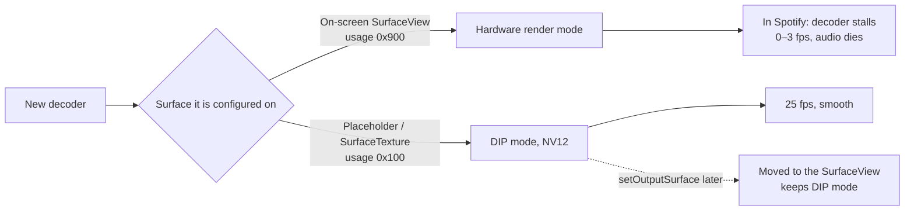

# Spotify music videos on TCL / MStar Android TVs: root cause and fix

<p align="center">
  <b>Spotify music videos drop to ~2 fps and lose their audio the moment you skip, autoplay or the quality goes up.</b><br>
  This repo explains why, down to the vendor decoder, and patches the Spotify TV app so they play smoothly. No root needed.
</p>

<p align="center">
  
  
  
  
</p>

---

## TL;DR

| | |
|---|---|
| **Symptom** | The first music video plays fine. Skip to the next one, let it autoplay, or let the quality step up, and the picture drops to about one frame every few seconds. A few seconds later the audio stops. |
| **Root cause** | The TV's hardware decoder (`libOMX.MStar.so`) picks its output mode once, when it is set up. Set up directly on an **on-screen `SurfaceView`**, it picks a "hardware render" path, and in Spotify that path stalls at 0–3 fps. Spotify sets up a new decoder for every video and every quality change, always on its on-screen `SurfaceView`. (Google's Media3 demo app uses the same path on the same TV without stalling, so something specific to Spotify's player is also involved. See [what we don't know yet](#what-we-dont-know-yet).) |
| **Fix** | Patch Spotify's player (Media3) so every decoder is first set up on an **off-screen placeholder surface**, which gets the working mode, then moved to the real screen right before its first frame. |
| **Root needed?** | No. The patched app is re-signed with your own key and installed over adb. |

---

## The hardware

| | |
|---|---|
| TV | TCL "Smart TV Pro" 4K, sold as **55C825** (product `G05_4K_GB`, device `G05`) |
| SoC | **MediaTek / MStar MT5889**, `armeabi-v7a` (32-bit userspace), Mali GPU, ~2.7 GB RAM |
| Panel / UI | 3840×2160 panel; Android UI at 1920×1080, 60 Hz (50 Hz mode available) |
| OS | Android TV 11, build `AR2101`, fingerprint `TCL/G05_4K_GB/G05:11/AR2101/AR28` |
| Firmware | **`V8-T615T03-LF1V620`** (built 13 Jun 2025, security patch 2025-05-05), the latest TCL published for this chassis |
| Video decoder | `OMX.MS.AVC.Decoder` from `/vendor/lib/libOMX.MStar.so` (adaptive playback, max 1920×1080) |
| App | Spotify for Android TV `com.spotify.tv.android` **9.1.94.1926**; player "Betamax" on **AndroidX Media3 1.11.0** |

Other TVs built on the MStar/MediaTek `T615`/`MT58xx` TV platforms (several TCL, Philips and Sharp models) use the same decoder library. They are likely affected too, but they haven't been tested.

---

## Symptoms

- The first video after opening Spotify plays perfectly.
- **Skipping** to another video while one is playing breaks it.
- **Autoplay** from one video to the next breaks it.
- **Quality going up** mid-video can break it.
- Going back to the menu and choosing the next video works, and so does force-closing the app.
- Once broken, the picture shows about one new frame every few seconds. Spotify then flips between *playing* and *buffering* about 3× per second, and the audio track is restarted until the audio dies too.

---

## Root cause

### 1. The decoder chooses its mode from the surface's consumer usage

When `OMX.MS.AVC.Decoder` sets up its output buffers, it asks the output surface for its **consumer usage** bits, and the answer decides the whole pipeline:

```text
GOOD  MS_OSAL_BUFFER: ConsumerUsage: 100, Hardware Render: 0
      Enable DIP Detile/MFDEC ... SW render with DIP-MFDEC support, change color format to NV12
      gralloc buffers 1920x1088 usage 0x2400930 → MSTAR_VDEC_DBG Rate : 23–25

BAD   MS_OSAL_BUFFER: ConsumerUsage: 900, Hardware Render: 1
      GRM: AcquireDispBuf OK: 0   (no DIP, takes the single display buffer)
      1.8 KiB metadata buffers usage 0x42000900
      → in Spotify: MSTAR_VDEC_DBG Rate : 0–3
```

- `0x100` is `GRALLOC_USAGE_HW_TEXTURE`, a GPU texture consumer, as with a `SurfaceTexture`.
- `0x900` adds `GRALLOC_USAGE_HW_COMPOSER`, an on-screen layer, as with a `SurfaceView`.

In "hardware render" mode the decoder hands out tiled frames meant for the TV's video plane. In Spotify the decoder then produces only 0–3 frames per second. In one capture SurfaceFlinger's Mali driver was also de-tiling every frame on the GPU; in a later one the video layer was on the display hardware and the decoder still stalled.

### 2. Spotify always sets up its decoder on the on-screen `SurfaceView`

Spotify's TV player (Media3 `MediaCodecVideoRenderer`) does this:

```text
new video / quality change
  └─ release the old MediaCodec, create a new OMX.MS.AVC.Decoder
       └─ configure(surface = the SurfaceView already on screen)   ← consumer usage 0x900 → broken
```

Media3 only uses its off-screen **placeholder surface** when no display surface exists yet. That happens for exactly one decoder: the first one after Spotify opens, or after going back to the menu, when the video view's surface hasn't been created yet. That's the "first video works" pattern.



### 3. Why no setting can fix it without root

- Every decoder property the library reads is a `vendor.mstar.*` / `vendor.mtk.*` property, for example `vendor.mstar.render.planar` and `vendor.mtk.grm.displaybuffer.num`. On a user build these are SELinux-protected: `setprop` fails from adb.
- The software decoder (`c2.android.avc.decoder`) is ranked after the hardware one. Changing the ranking needs a media-server restart, which needs root.
- Developer options don't help: *Disable HW overlays* and locking 60 Hz were tested with no change.
- There's no firmware update: V620 is the last one TCL published.

### What we don't know yet

Google's Media3 demo app on the same TV also sets up new decoders on its on-screen `SurfaceView`, and gets the same `ConsumerUsage: 900, Hardware Render: 1` mode, but plays smoothly:

| Demo app test | Result |
|---|---|
| 720p H.264 → HEVC → H.264 playlist (new decoder while video is on screen) | 29–31 fps |
| 25 fps HEVC, with the display switching 60 → 50 Hz | 24–25 fps |
| 1080p60 H.264 DASH, new decoder while video is on screen | 58–62 fps |

So hardware-render mode is only harmful in combination with something Spotify's player does. Spotify's video layer isn't marked secure, and its app window looks the same as the demo's. The exact trigger is still unknown. The placeholder-first patch avoids it by keeping Spotify's decoders out of hardware-render mode.

The full investigation, with every dead end, is in [`docs/INVESTIGATION.md`](docs/INVESTIGATION.md).

---

## The fixes

Both fixes are small edits to the Spotify app. The scripts find the code to change by its structure, not by the obfuscated class names (`b`, `R0`, …), which change in every Spotify version.

### ✅ Placeholder-first (recommended)

[`patches/placeholder`](patches/placeholder) adds a small helper class, [`PlaceholderFirst`](patches/placeholder/PlaceholderFirst.smali.tmpl), to Media3's video renderer:

1. **When a decoder is set up**, it's given Media3's placeholder surface instead of the on-screen `SurfaceView`. The decoder sees usage `0x100` and picks the working DIP mode.
2. **Right before the first frame is rendered**, the decoder is moved to the real `SurfaceView` with `MediaCodec.setOutputSurface()`. It keeps the DIP mode.

Video stays on its own `SurfaceView` layer, so menus drawn over a playing video stay smooth. This covers skips, autoplay and mid-video quality changes, because all of them create their decoder through the same renderer code.

### 🛟 TextureView (fallback)

[`patches/textureview`](patches/textureview) turns off the player-config flag that makes Spotify use a `SurfaceView`, so Spotify falls back to its built-in `TextureView` mode. Every decoder then gets usage `0x100`.

It works on its own, but video frames are then drawn by the app's own UI thread, so opening a menu over a playing video hitches for a moment. Keep it for the case where a future Spotify version breaks the placeholder patch.

### ❌ What didn't work

| Attempt | Result |
|---|---|
| Lock the display at 60 Hz (`min_refresh_rate`) | Stops the 60↔50 Hz flicker, not the bug |
| Developer options → *Disable HW overlays* | Still `ConsumerUsage: 900` |
| `setprop vendor.mstar.*` | Blocked by SELinux |
| Swap in a brand-new `SurfaceView` before every video | Still `900`: the new surface exists long before the decoder is set up |

---

## Install

> [!WARNING]
> This modifies and re-signs the Spotify app for your own use. It isn't affiliated with or endorsed by Spotify, TCL or MediaTek. Modifying the app may breach Spotify's terms of service, so use it at your own risk. This repo contains no Spotify code or APKs: the scripts patch the copy installed on your own TV.

### Requirements

- A Mac or Linux machine on the same network as the TV
- The TV with **Developer options → USB/Network debugging** enabled
- `adb`, `apktool`, Java 17+, Python 3 and the Android build-tools (`apksigner`, `zipalign`). On macOS:

```bash
brew install android-platform-tools apktool openjdk@21 && brew install --cask android-commandlinetools
```

### Steps

1. Install Spotify on the TV from the Play Store (the official build is required, and the script checks its signature).
2. Clone this repo and run:

   ```bash
   ./repatch.sh <tv-ip>
   ```

   The script:
   - pulls Spotify from the TV and verifies it's Spotify's signed build;
   - applies the placeholder fix and signs the result with a key it creates in `local/`;
   - uninstalls the official app and installs the patched one.

   For the fallback, use `./repatch.sh <tv-ip> --textureview`. To build without touching the TV, add `--dry-run`.
3. Open Spotify on the TV and log in again.

### Updating Spotify later

The Play Store can't update the patched app, because its signature differs. To move to a newer version:

1. Uninstall the patched Spotify on the TV.
2. Install Spotify from the Play Store.
3. Run `./repatch.sh <tv-ip>` again.

Keep `local/patch.keystore`: a later build can only replace the installed patched app if it's signed with the same key.

### Undo

Uninstall the patched Spotify on the TV and install it from the Play Store.

---

## Verify it yourself

Watch the decoder choose its mode while you skip between videos:

```bash
adb -s <tv-ip>:5555 logcat | grep -E "ConsumerUsage:|PlaceholderFirst|MSTAR_VDEC_DBG.*Rate"
```

With the fix, every new video logs `decoder configured on placeholder surface`, then `ConsumerUsage: 100, Hardware Render: 0` and `moved decoder to the real surface`.

## Compatibility

| Spotify TV | Placeholder fix | TextureView fix |
|---|---|---|
| 9.1.94.1926 | ✅ tested on the TV | ✅ tested on the TV |
| newer | should apply; the script stops with a clear error if the code changed | should apply |

If you try another TV model or Spotify version, please open an issue with your model, firmware and result.

## License

[MIT](LICENSE) for the scripts and the helper class in this repo. Spotify, TCL, MediaTek and MStar are trademarks of their respective owners.
