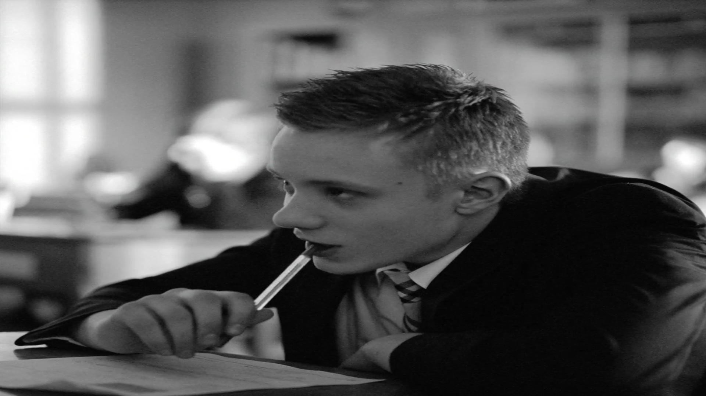
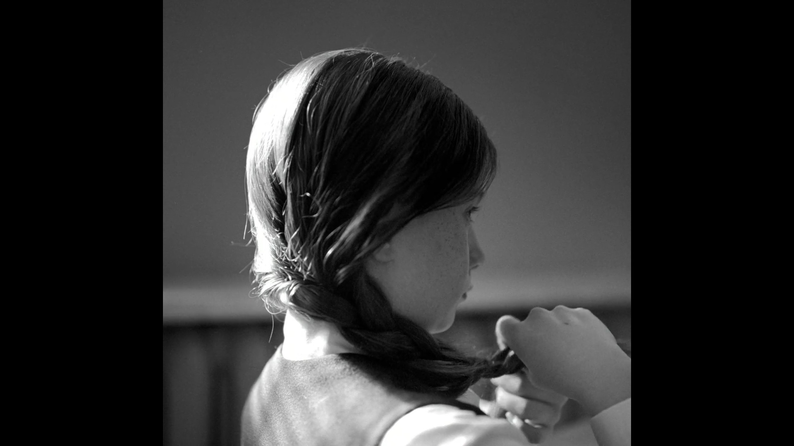

# Stretched music videos on Android TV

A separate problem from the stutter. Spotify's TV app stretches every music video that isn't 16:9 to fill the screen. There's no setting for it, in Spotify or on the TV.

## What it looks like

Indochine's *College Boy*, 1132×1080 (almost square), on a TCL 55C825:

| Stock Spotify: 1.70× too wide | With the fix |
|---|---|
|  |  |

Measured on the TV (video size vs. where Android draws it):

| Video | Real picture | Drawn as | Too wide by |
|---|---|---|---|
| Indochine – College Boy | 1132×1080 (≈1:1) | 1920×1080 | **1.70×** |
| Since U Been Gone | 634×480 (4:3) | 1920×1080 | 1.35× |
| Hootie Frutti | 1420×1080 (4:3) | 1920×1080 | 1.35× |
| Tate McRae – Housewife | 1590×1080 (1.47:1) | 1920×1080 | 1.21× |

16:9 videos are unaffected.

## Cause

Spotify's video view has four scale modes (`ASPECT_FIT`, `ASPECT_FILL`, `ASPECT_FILL_DISPLAY_AR`, `STRETCH`), and the TV app picks `ASPECT_FILL`. When the video renders through a `TextureView`, that mode crops through a transform matrix. When it renders through a `SurfaceView`, which is what TVs get, the view lays the `SurfaceView` out at the container's full size, so the video is scaled to the screen whatever its shape.

The app also passes the decoded width and height to the view and ignores Media3's `pixelWidthHeightRatio`.

Nothing here is specific to TCL or MediaTek, so it probably affects every Android TV.

## The fix

[`patches/aspect`](../patches/aspect) makes two edits, found by code shape:

1. Every place that picks `ASPECT_FILL` picks `ASPECT_FIT` instead, so the `SurfaceView` takes the video's own shape, centred, with black bars where the shapes differ.
2. The width given to the view is multiplied by Media3's pixel aspect ratio, so anamorphic streams come out right too.

Add `--aspect` to the install command:

```bash
./repatch.sh <tv-ip> --aspect
```

It combines with any of the stutter fixes (for example `--textureview --aspect`).

On the TV, *Housewife*'s video layer went from `displayFrame 0,0–1920,1080` to `165,0–1755,1080`, a 16:9 video still filled the screen, and skips stayed at 24 fps.
